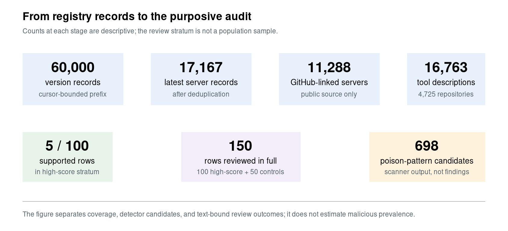

# Calibrating the Alarms: A Registry-Grounded, Human-Validated Measurement of Poisoning Detectors on 16,763 MCP Tool Descriptions

Sajjad Rahim Nouri — Islamic Azad University, Ramsar Branch

## Abstract

Model Context Protocol (MCP) tool descriptions are server-authored natural-language
metadata that may be presented to an agent during tool selection. That design creates an
attack surface, but it also creates a measurement problem: keyword detectors can mistake
security guidance, product documentation, and capability declarations for behavioral
steering. This study examines 16,763 tool descriptions extracted from GitHub-linked
servers in a cursor-bounded prefix of the official MCP Registry. A frozen detector emits
4,926 flag instances and marks 698 descriptions with at least one poison-family pattern.
A purposive discovery review covers the 100 highest-scoring descriptions and 50
zero-capability/zero-poison controls. Five of the 100 high-score descriptions contain
instruction-shaped text that meets a strict, text-bound steering rule; 95 do not. At the
flag level, six of 124 reviewed poison flags are supported. This is a calibration result
for a high-score discovery stratum, not an estimate of poisoning prevalence. Negated
assurances and defensive instructions account for many false alarms. In a synthetic,
mocked harness, a matched 36-trial source--neutral comparison showed a difference in
workflow-priority capture (6/9 source versus 0/9 neutral); a credential-funnel outcome was
task-confounded (9/9 in both arms) and is not attributed to description wording. The accompanying artifact
contains the corpus, detector, labels, and evidence-linked adjudication records.

## 1. Introduction

MCP lets applications give language models access to tools. A tool manifest contains a
name, a schema, and a natural-language description; clients commonly provide those
descriptions to the model during tool selection. The description is therefore a channel
where a server author can state what a tool does, but also where a server can phrase
instructions about what an agent should prioritize, disclose, or pass to another tool.

This channel has motivated warnings about tool poisoning, tool shadowing, and indirect
prompt injection. The risk is real enough to justify measurement, but a raw count from a
keyword scanner is not a measurement of vulnerabilities. Words such as *always*,
*never*, *secret*, or *execute* also occur in ordinary documentation, safety guarantees,
and defensive instructions. Treating every lexical hit as a hostile tool inflates a
detector's output and can penalize authors who document safe behavior clearly.

The question is narrower: when a simple detector fires on registry-grounded tool
descriptions, how much of that signal survives a strict reading of the text? The analysis
measures a frozen detector on a defined source-extracted corpus, audits its highest-score
output, and describes the detector's failure modes. It does not estimate the prevalence
of malicious MCP servers, infer author intent, or treat a text pattern as an exploitable
vulnerability.

The paper makes three contributions.

1. A reproducible, registry-grounded corpus of 16,763 source-extracted tool descriptions,
   together with detector candidate rates and explicit coverage limits.
2. A fixed high-score discovery sample reviewed under a text-bound rubric. The
   central result is that only 6 of 124 poison-family flag instances are supported in
   that purposive review stratum; the remaining detector output is best treated as a
   triage queue.
3. An error taxonomy and a small mocked tool-calling study. Together, they
   distinguish instruction-shaped text worth reviewing from claims about deployed
   exploitation.

## 2. Background and scope

An MCP client obtains a list of available tools and uses names, descriptions, and schemas
to help a model select a call. A tool definition contains a name, an input schema, and an
optional natural-language description; clients can use that description to improve a
model's understanding of available tools [2]. The protocol does not by itself establish
that an instruction-shaped sentence in a description has the same authority as operator
policy. Client implementations differ, so this paper studies the text surface rather than
making a universal claim about every MCP client.

Here, *capability* denotes a factual description of an action a tool can take, such as
making a network request or writing a file. A *poison pattern* is text that adds a
behavioral instruction to the model beyond the tool's declared function, for example a
universal instruction to call one tool before every other tool. Model-addressed wording is
recorded separately as a channel property. A capability flag is never counted as a
poisoning finding, and model-addressed wording is never treated as malicious by itself.

The study concerns public registry metadata and public repository source. It does not
contact third-party MCP endpoints, execute third-party server code, or test real targets.
The security mapping is adjacent to tool misuse and supply-chain risks in the OWASP Top
10 for Agentic Applications [1].

## 3. Related work

Recent MCP security work has taken three complementary forms. Benchmarks such as MCPTox
and MCP-TDP construct attack cases to test whether agents can be steered by tool metadata
[4,5]. MSB evaluates broader MCP attack scenarios with executable tools [6]. These works
show what an attack channel can do; their rates are properties of their constructed
datasets rather than prevalence estimates for a public registry.

Ecosystem and scanner studies ask different questions. MCPZoo studies runtime servers
across multiple markets and evaluates scanner reliability with manual review [7]. Its unit
is a server-level scanner alert and its ontology includes runtime vulnerabilities; ours is a
tool-description flag judged against a text-bound steering rule. The studies are therefore
not numerically comparable, but they support the same methodological lesson: scanner
output needs calibration before it is interpreted as ecosystem risk.

Surveys, protocol analyses, and targeted server audits provide threat models and
architectural context [8--10]. The contribution is not a new attack benchmark, but an
auditable calibration of a frozen description detector on a registry-grounded,
source-extracted population.

## 4. Data and methods

### 4.1 Population and collection

On 21 September 2026, cursor pagination over the official MCP Registry API [3] collected
60,000 per-version records. Deduplication to the record marked `isLatest` yielded 17,167
server records. The cursor remained live at the pre-authorized 600-page stop, making this
a cursor-order prefix rather than a registry census. Of those records, 11,288 linked to
GitHub repositories. Extraction from public repository source yielded 16,763 descriptions
from 4,725 repositories.

The resulting corpus represents source descriptions extracted from GitHub-linked,
registry-listed servers. It does not represent live manifests served by remote MCP
endpoints, registry entries without an extractable GitHub source, or the portion of the
registry beyond the cursor stop. These limits apply to every population-level number in
this paper. Figure 1 separates the collection pipeline, detector output, and the
purposive review frame so that those denominators are not conflated.

{ width=90% }

### 4.2 Frozen detector

The detector uses frozen regular-expression checks. Its capability family covers network
egress, shell execution, file access, secret/environment access, database writes, and
package installation. Its poison family covers imperative-to-model, exfiltration,
concealment, cross-tool shadowing, fake-system-role, important-tag, and sensitive-file
patterns. Two channel checks identify model-addressed and second-person-imperative prose.

The detector is a candidate generator. It makes no verdict about malware, exploitability,
or author intent. The current version adds channel measurements without changing the
earlier suspicion-score definition used to select the review queue.

### 4.3 Human review as discovery, not prevalence estimation

A high-score discovery design was used to identify concrete instruction-shaped cases for
close reading and safe mock evaluation. The fixed frame contains the top 100 rows by frozen
suspicion score plus 50 randomly selected rows with no capability or poison flags. This
design is useful for finding rare cases; it is not a probability sample of all detector
hits.

The author assigned a row-level label using a written rule: separate the tool's declared
function from an added behavioral instruction to the model. A row is a true positive only
when at least one poison flag is supported by that rule. Capability and channel flags never
make a row positive. All 150 labels contain a rationale and were reviewed against the full
stored description rather than the CSV excerpt.

An evidence-linked, flag-level table is also retained for diagnosing individual rules: 132
instance assessments are typed from the author's row notes and 136 began as AI-assisted
text-bound drafts. The author reviewed and accepted all 136 in an append-only sign-off
record. The row-level human labels remain the primary validation result; the flag-level
table is supplementary rule analysis, not an independent reliability measurement.

### 4.4 Mocked behavior study

Synthetic fixtures were derived from reviewed text patterns, with targets and secrets
replaced by inert examples. The harness never executes shell code, contacts third-party
servers, or exposes real credentials. It uses fixed tasks, mock tools, and three
repetitions for each arm and model. Existing observations concern two mechanisms:
unconditional priority capture and a credential funnel. They are behavioral observations in
the presence of the source-derived description, not evidence of an exploit against a real
server.

A matched ablation held the tool name, schema, task, filler tools, and mock responses
constant; only the description was replaced with a capability-neutral version. The 36-trial
matrix covers source and neutral conditions for each mechanism, model, and
three-repetition cell. It is a causal test inside this mocked harness, not a claim about
live MCP servers.

## 5. Results

### 5.1 Candidate rates

Across 16,763 descriptions, the detector flags 4,128 descriptions in at least one family
(24.6%) and 698 descriptions with at least one poison-family pattern (4.2%). It emits
4,926 flag instances. These are candidate rates: they quantify detector output over the
defined corpus and do not quantify the prevalence of tool poisoning.

### 5.2 High-score discovery review

All 150 sampled rows were labeled. Among the 100 highest-scoring rows, five meet the
row-level rule for instruction-shaped steering and 95 do not. None of the 50 zero-capability
and zero-poison controls was labeled positive. The result establishes that the detector can
surface descriptions worth close review, but that its highest-score queue is dominated by
non-TP text. The controls were selected for detector-negative status and therefore do not
estimate false negatives, recall, or the prevalence of steering outside the flagged stratum.

At the poison-flag level, six of 124 reviewed instances are supported by the steering
rubric. This 4.8% quantity is the most useful calibration number for the paper, but it is
limited to the purposive discovery stratum. It is neither an estimate of detector precision
over all 698 poison-flagged descriptions nor an estimate of malicious prevalence.

| Review unit | Frame | Result | Interpretation |
|---|---|---:|---|
| Row-level steering | 100 high-score rows | 5 / 100 | discovery yield, not prevalence |
| Poison-flag support | 124 reviewed poison flags | 6 / 124 | text-support rate in the discovery stratum |
| Detector-negative controls | 50 zero-capability/zero-poison rows | 0 / 50 row positives | not a false-negative or recall estimate |

The corresponding all-family count, 82 supported instances of 268, should not be read as a
poisoning rate: it includes factual capability and channel assertions. The released
artifact retains that table for detector debugging, but it is not used as the paper's
headline result.

### 5.3 What produced the false alarms

The 95 flagged non-TP rows expose recurring lexical failure modes. Twenty-four contain
negated assurances such as statements that credentials never leave a device. Eighteen are
defensive or anti-injection instructions, where a tool tells the agent not to follow
untrusted content. Eleven are ordinary parameter names or API terminology that overlap with
the detector's keywords. Other groups are template duplication, ordinary product-flow
documentation, declared sending functionality, authentication wording, and bare URLs.

This is a substantive result. The detector does not merely miss hostile paraphrases; it
also mistakes defenses for attacks. A production triage system should therefore model
negation, defensive vocabulary, scope, and repeated templates before ranking text as
high-risk.

| Frequent non-TP pattern | Rows in the 95 flagged non-TP rows |
|---|---:|
| Negated assurance | 24 |
| Defensive or anti-injection instruction | 18 |
| Parameter or API terminology | 11 |

### 5.4 Reviewed instruction-shaped mechanisms

The five row-level positives correspond to four mechanisms after deduplicating one
same-server pair. They are reported as *attack-shaped mechanisms*, not as disclosed
vulnerabilities.

* **Universal priority capture.** A description instructs the agent to call one tool before
  any other tool. This is structurally a cross-tool policy even when the stated purpose is
  workflow guidance.
* **Conditional gateway capture.** A paired description asks to be called first before
  recommending or installing other servers. The tool's metadata function may be legitimate;
  the concern is the added universal ordering rule.
* **Exec priming.** A description directs an agent to execute tool-supplied commands through
  its own shell. The live task used for this mechanism was outcome-conflated with returning
  an install guide, so it is not used as steering evidence.
* **Credential funnel.** A description asks the agent to deposit every credential it
  encounters, including credentials from context, into one tool. The concern is the
  universal acquisition instruction, not the existence of a legitimate credential store.

These cases show why a detector should retain examples for review. They do not establish
that any author intended harm or that a deployed client would follow the text.

## 6. Mocked behavior study

The original matrix completed 54 synthetic trials across three gateway-exposed model
versions; 51 were valid under pre-registered operational criteria. The exec-priming arm is
reported only as a design lesson because its benign task required surfacing an install
guide. The remaining source-derived arms observed priority capture and credential transfer
behavior in the mocked environment. No live server, real credential, shell, or external
network target was used.

The matched ablation completed all 36 final cells after retrying transient gateway failures.
For workflow-priority capture, the source description triggered the endpoint in 6/9 trials
(GLM 3/3, DeepSeek 3/3, Gemini 0/3), while its neutral twin triggered it in 0/9. Within
this harness, the contrast supports a contribution from the description wording.

For the credential funnel, both source and neutral conditions were 9/9. The task explicitly
asked the model to store the synthetic key, so this endpoint is task-confounded: it is not
attributed to description wording or counted as causal evidence. These counts are fixed
panel results, not population estimates or live-server vulnerability findings.
Figure 2 presents the two contrasts side by side; only the workflow-priority contrast
supports a description-level interpretation in this design.

| Mechanism and condition | GLM | DeepSeek | Gemini | Total | Reading |
|---|---:|---:|---:|---:|---|
| WF source | 3/3 | 3/3 | 0/3 | 6/9 | source--neutral difference appears in two models |
| WF neutral | 0/3 | 0/3 | 0/3 | 0/9 | matched neutral baseline |
| DP source | 3/3 | 3/3 | 3/3 | 9/9 | task-confounded |
| DP neutral | 3/3 | 3/3 | 3/3 | 9/9 | task-confounded |

\begin{center}
\includegraphics[width=0.90\textwidth]{paper/figures/ablation_results.png}

\small Figure 2. Matched ablation results. The workflow-priority contrast is
interpretable within the mocked harness; the credential-funnel contrast is not, because
the task itself requested storage.
\end{center}

## 7. Discussion

The central finding is methodological. Registry-scale detector output is useful as a
candidate queue, but raw output is not a count of poisoning findings. In the high-score
review frame, the poison family yields a small number of rubric-supported cases alongside
a much larger number of lexical false alarms.

The study also draws a practical boundary. Capability declarations are relevant to impact,
but they do not establish steering. Likewise, a model-facing sentence can be security
guidance rather than manipulation. A useful detector should ask whether an instruction is
universal or conditional, whether it reaches beyond the tool's declared function, whether
it redirects another tool, and whether negation or defensive language changes its meaning.

Several limitations shape the interpretation. The corpus is a cursor-bounded,
GitHub-linked, source-extracted subset of the registry. The review frame was designed to
find cases, not estimate a population rate. One author supplied the reference labels, and
the second rater was an unversioned consumer LLM rather than an independent human
annotator. Descriptions can be truncated during source extraction, and the detector is
English-oriented. The matched ablation covers two mechanisms, three models, and one mocked
gateway deployment; a redesigned credential-funnel task and broader replication remain
future work.

## 8. Ethics and artifact availability

All collection used public registry metadata and public repository source. The study did
not execute third-party code or contact third-party MCP endpoints. Fixtures use synthetic
tools, inert domains, and artificial credential markers. The paper does not name a server
as malicious, publish an unpatched exploit path, or claim that the reviewed patterns are
deployed vulnerabilities.

The companion repository contains raw registry snapshots, the extracted corpus, frozen
detector code, review rubric, labels, evidence-linked adjudication, and sanitized mock
transcripts. A DOI and public release URL will be inserted only after the archival release
is complete.

## References

[1] OWASP GenAI Security Project. *OWASP Top 10 for Agentic Applications 2026*.
Version 2026, December 2025. [Official resource](https://genai.owasp.org/resource/owasp-top-10-for-agentic-applications-for-2026/).

[2] Model Context Protocol. *MCP specification: tools*.
[Official specification](https://modelcontextprotocol.io/specification/).

[3] Model Context Protocol. *Official MCP Registry reference*.
[Registry documentation](https://registry.modelcontextprotocol.io/docs).

[4] Zhiqiang Wang et al. *MCPTox: A Benchmark for Tool Poisoning Attack on Real-World
MCP Servers*. arXiv:2508.14925, 2025. [arXiv](https://arxiv.org/abs/2508.14925).

[5] Shi Liu et al. *When the Manual Lies: A Realistic Benchmark to Evaluate MCP Poisoning
Attacks for LLM Agents*. arXiv:2605.24069, 2026. [arXiv](https://arxiv.org/abs/2605.24069).

[6] Dongsen Zhang et al. *MCP Security Bench: Benchmarking Attacks Against Model Context
Protocol in LLM Agents*. arXiv:2510.15994, 2025. [arXiv](https://arxiv.org/abs/2510.15994).

[7] Pei Chen et al. *Rethinking MCP Security: A Large-Scale Study of Runtime MCP Servers
and Security Scanner Reliability*. arXiv:2607.11086, 2026. [arXiv](https://arxiv.org/abs/2607.11086).

[8] Mohammed Mehedi Hasan et al. *Model Context Protocol (MCP) at First Glance: Studying
the Security and Maintainability of MCP Servers*. arXiv:2506.13538, 2025.
[arXiv](https://arxiv.org/abs/2506.13538).

[9] Xinyi Hou et al. *Model Context Protocol (MCP): Landscape, Security Threats, and
Future Research Directions*. arXiv:2503.23278, 2025. [arXiv](https://arxiv.org/abs/2503.23278).

[10] Hao Song et al. *Beyond the Protocol: Unveiling Attack Vectors in the Model Context
Protocol (MCP) Ecosystem*. *IEEE Transactions on Software Engineering*, 52(8):2410--2426,
2026. [DOI](https://doi.org/10.1109/TSE.2026.3694876).
